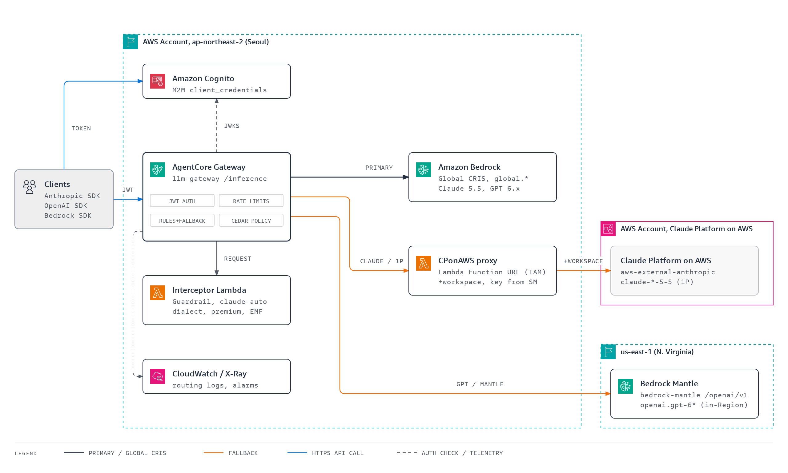
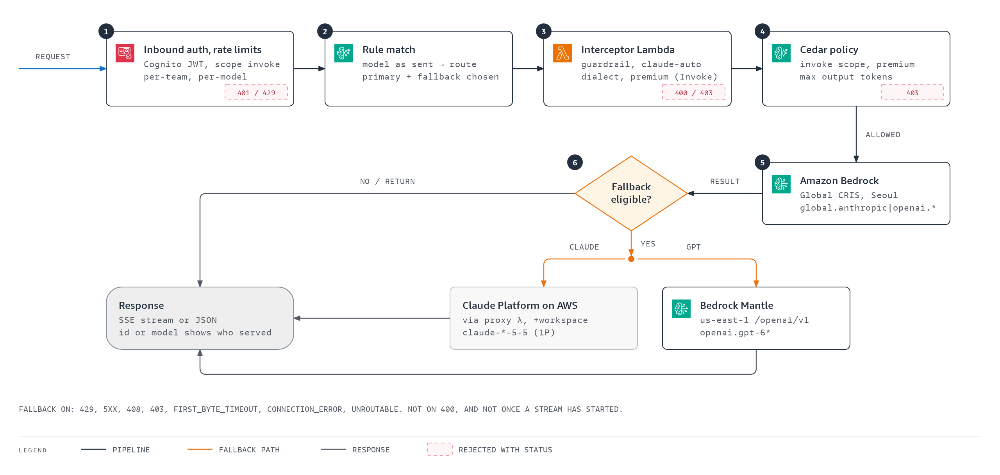
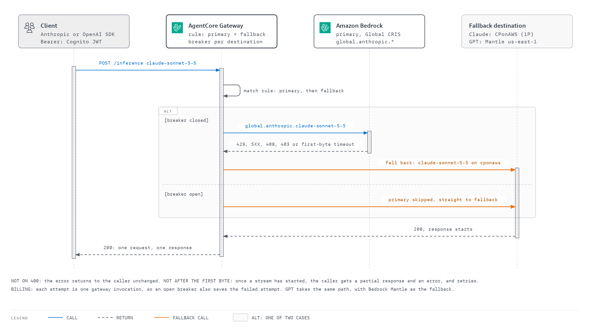
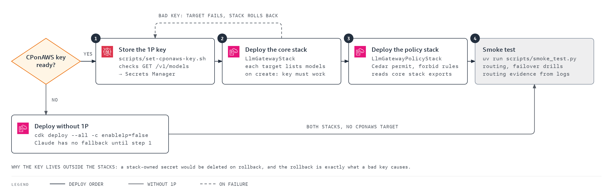
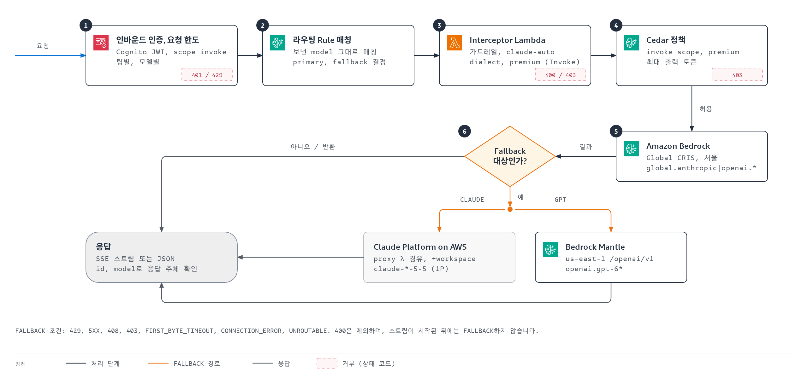
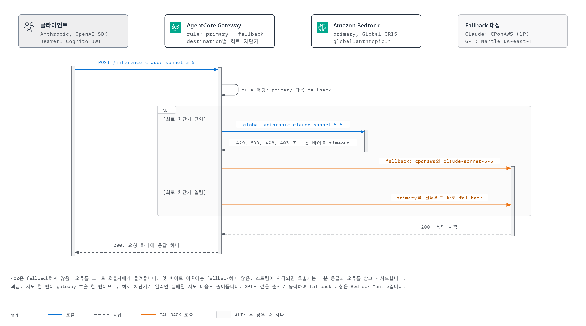
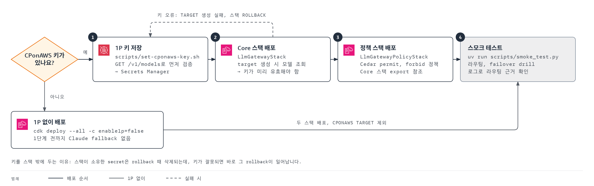

# AgentCore LLM Gateway

[](CHANGELOG.md)
<a href="#english"></a>
<a href="#korean"></a>

One LLM endpoint on Amazon Bedrock AgentCore Gateway (Seoul) for Claude and GPT, with Bedrock Global CRIS first and automatic fallback | Amazon Bedrock AgentCore Gateway(서울) 위의 Claude, GPT 단일 LLM 엔드포인트, Bedrock Global CRIS 우선과 자동 fallback

---

<a id="english"></a>

# English

## Overview

An LLM gateway built on Amazon Bedrock AgentCore Gateway in ap-northeast-2 (Seoul). Clients call one endpoint for Claude 5.5 (Opus, Sonnet, Haiku) and GPT 6.x (6.1 Sol, 6.1 Terra, 6 Astra, 6 Sol, 6 Luna). Every request goes to **Bedrock Global CRIS** first and falls back automatically per model family: Claude to **Claude Platform on AWS (1P, CPonAWS)**, GPT to **Bedrock Mantle in us-east-1** (in-Region model IDs, separate capacity and quotas).

<!-- TODO: add a demo image or GIF -->

## Features

- **Per-family fallback** — Bedrock Global CRIS primary; Claude falls back to Claude Platform on AWS and GPT to Bedrock Mantle us-east-1 on 429, 5XX, 408, 403, connection errors, and first-byte timeouts, with a circuit breaker.
- **One endpoint, three SDKs** — Anthropic Messages, OpenAI Chat Completions and Responses, and Bedrock InvokeModel on `/inference`; clients hold only a Cognito JWT.
- **Team governance** — per-team RPM, TPM, and concurrent-connection limits, Cedar policies for premium models and output-token caps, and a Bedrock Guardrail on every path.
- **Routing controls** — aliases, interceptor-driven `claude-auto`, a 90/10 A/B experiment, and failover drills that exercise each fallback on demand.
- **Observability** — vended routing logs and traces, metric filters that count fallbacks, a CloudWatch dashboard, and alarms.

## Architecture





The same fallback over time: with the circuit breaker closed, the gateway tries Bedrock first and moves on after a trigger; with it open, the gateway skips the primary.



Request flow as a Mermaid summary (same zones and colors as the diagrams above):


Details: [docs/architecture.md](docs/architecture.md). Vector versions: [architecture.en.svg](docs/architecture.en.svg), [request-flow.en.svg](docs/request-flow.en.svg), [fallback-sequence.en.svg](docs/fallback-sequence.en.svg), [deploy-order.en.svg](docs/deploy-order.en.svg); interactive page: [docs/architecture.en.html](docs/architecture.en.html).

| Model the client sends | API | Primary | Fallback |
|---|---|---|---|
| `claude-opus-5-5`, `opus`, `anthropic.claude-opus-5-5`, `global.anthropic.claude-opus-5-5` | Messages | bedrock / `global.anthropic.claude-opus-5-5` | cponaws / `claude-opus-5-5` |
| `claude-sonnet-5-5`, `sonnet`, ... | Messages | bedrock / `global.anthropic.claude-sonnet-5-5` | cponaws / `claude-sonnet-5-5` |
| `claude-haiku-5-5`, `haiku`, ... | Messages | bedrock / `global.anthropic.claude-haiku-5-5` | cponaws / `claude-haiku-5-5` |
| `gpt-6.1-sol`, `openai.gpt-6.1-sol`, `global.openai.gpt-6.1-sol` | Chat Completions, Responses | bedrock / `global.openai.gpt-6.1-sol` | mantle / `openai.gpt-6.1-sol` |
| `gpt-6.1-terra`, `gpt-6-astra`, `gpt-6-sol`, `gpt-6-luna` (same forms) | Chat Completions, Responses | bedrock / `global.openai.<model>` | mantle / `openai.<model>` |
| `claude-auto` | Messages | interceptor picks a Bedrock Claude model by prompt size | cponaws / `claude-sonnet-5-5` |
| `claude-experiment` | Messages | 90% Sonnet / 10% Opus (`weightedRoute`) | each leg's fallback |
| `claude-haiku-5-5-failover-drill` | Messages | primary with a 50 ms first-byte timeout (always stalls) | cponaws / `claude-haiku-5-5` |
| `gpt-6-luna-failover-drill` | Chat Completions, Responses | primary with a 50 ms first-byte timeout (always stalls) | mantle / `openai.gpt-6-luna` |

| Requirement | Implementation | Where |
|---|---|---|
| One endpoint, SDK compatibility | Gateway `/inference` | `lib/llm-gateway-stack.ts` |
| Multiple providers | `bedrock-runtime` connector target, CPonAWS and Mantle provider targets | `lib/llm-gateway-stack.ts` |
| Credential abstraction | Clients hold only a Cognito JWT; the gateway role signs to Bedrock, Mantle, and the CPonAWS proxy, and only the proxy reads the CPonAWS key | `lib/constructs/cponaws-proxy.ts` |
| Model routing and fallback | `matchModels` rules with `staticRoute.model` and a `fallback` chain | `lib/config.ts` |
| A/B testing | `weightedRoute` 90/10 | `lib/config.ts` |
| Team quotas | `$.context.jwt.client_id` RPM/TPM/connections; `qualifiedModelId` TPM | `lib/llm-gateway-stack.ts` |
| RBAC and token caps | Cedar policies; on InvokeModel paths the interceptor enforces premium models and the token cap, and refuses unknown models | `lib/policy-stack.ts`, `lambda/interceptor/index.py` |
| Guardrail | Bedrock Guardrail (Standard tier, APAC profile) | `lib/constructs/guardrail-interceptor.ts` |
| Dynamic routing | `claude-auto` in the interceptor | `lambda/interceptor/index.py` |
| Model catalog | `GET /inference/v1/models` | built in |
| Observability | Vended logs and traces, dashboard, alarms, saved queries | `lib/constructs/observability.ts` |

## Prerequisites

- Node.js 22+ and npm
- AWS CLI v2 with credentials for the target account, and CDK bootstrap in ap-northeast-2
- `uv`, for `scripts/smoke_test.py`
- A Claude Platform on AWS API key and a Seoul workspace ID, for the Claude fallback

## Installation



```bash
# Clone the repository
git clone https://github.com/whchoi98/llm-gateway-on-agentcore.git
cd llm-gateway-on-agentcore

# Check tools, install dependencies, and install the commit-msg hook
bash scripts/setup.sh

# Prerequisite: verify and store the CPonAWS key (run in your own terminal; input is hidden)
./scripts/set-cponaws-key.sh

# Deploy the core stack, then the Cedar policy stack
npx cdk diff --all
npx cdk deploy --all
```

- The CPonAWS target lists models when it is created and fails on a bad key, so the key secret is a prerequisite that the stacks do not own.
- Without a key yet, deploy with `-c enable1p=false` (no Claude fallback).
- `-c policyMode=LOG_ONLY` records Cedar decisions without denying requests.
- `-c alarmEmail=you@example.com` subscribes an e-mail address to the alarms.

## Usage

Get an access token from the team secret `llm-gateway/clients/<team>` (`client_id`, `client_secret`, `token_url`); `scripts/gwlib.py` `token()` shows the request.

```python
import anthropic
client = anthropic.Anthropic(base_url=INFERENCE_ENDPOINT, auth_token=ACCESS_TOKEN)  # auth_token, not api_key
client.messages.create(model="claude-sonnet-5-5", max_tokens=1024,
                       messages=[{"role": "user", "content": "Hello"}])
```

```python
from openai import OpenAI
client = OpenAI(base_url=f"{INFERENCE_ENDPOINT}/v1", api_key=ACCESS_TOKEN)
client.chat.completions.create(model="gpt-6.1-sol", max_completion_tokens=1024,
                               messages=[{"role": "user", "content": "Hello"}])
client.responses.create(model="gpt-6-luna", input="Hello", max_output_tokens=1024)
```

```python
import os, boto3
os.environ["AWS_BEARER_TOKEN_BEDROCK"] = ACCESS_TOKEN      # Bedrock SDK: a bearer token instead of SigV4
br = boto3.client("bedrock-runtime", region_name="ap-northeast-2", endpoint_url=INFERENCE_ENDPOINT)
br.invoke_model(modelId="global.anthropic.claude-haiku-5-5", contentType="application/json", body=...)
```

To see who served a request: a Claude response `id` starting with `msg_bdrk_` came from Bedrock, and any other `msg_` id from CPonAWS; a GPT response `model` of `global.openai.*` came from Bedrock Global CRIS, and `openai.*` from Mantle.

## Configuration

| Variable | Description | Default |
|----------|-------------|---------|
| `AWS_PROFILE` | AWS credentials profile used by the CDK CLI, the AWS CLI, and the scripts | default credential chain |
| `LLM_GATEWAY_ENDPOINT` | Inference endpoint the scripts call | `InferenceEndpoint` from `cdk-outputs.json` |
| `ANTHROPIC_API_KEY` | CPonAWS key read by `scripts/set-cponaws-key.sh` | prompted |
| `ANTHROPIC_WORKSPACE_ID` | Seoul workspace ID for `scripts/set-cponaws-key.sh`, stored in the SSM parameter `/llm-gateway/anthropic-workspace-id` | the existing parameter, else a prompt |
| `EVIDENCE_SINCE` | Epoch seconds from which `smoke_test.py --only routing-evidence` reads routing logs | start of the run |

Models, fallbacks, teams, and limits live in `lib/config.ts`. Workspaces are region-bound, so the workspace ID must be a Seoul workspace; it is kept out of the repository in an SSM parameter that CloudFormation resolves at deploy time.

## Project Structure

```text
bin/            # CDK app entry point
lib/            # Stacks, constructs, and config.ts
lambda/         # Interceptor and CPonAWS proxy handlers
scripts/        # Smoke tests, key setup, setup and hook scripts; diagrams/ generator
tests/          # Harness tests
docs/           # Architecture, diagrams, reference docs, ADR and runbook templates
```

## Testing

```bash
# Typecheck
npm run build

# Harness tests (hooks, secret patterns, project structure)
bash tests/run-all.sh

# Live E2E against the deployed gateway (AWS credentials required; small cost)
uv run scripts/smoke_test.py

# Selected checks
uv run scripts/smoke_test.py --only gpt failover routing-evidence
```

## API Documentation

The gateway exposes these paths under `https://<gateway-id>.gateway.bedrock-agentcore.ap-northeast-2.amazonaws.com/inference`, all with `Authorization: Bearer <Cognito access token>`:

| Path | API | Models |
|---|---|---|
| `POST /v1/messages` | Anthropic Messages | Claude |
| `POST /v1/chat/completions` | OpenAI Chat Completions | GPT |
| `POST /v1/responses` | OpenAI Responses | GPT |
| `POST /model/{model}/invoke`, `/invoke-with-response-stream` | Bedrock InvokeModel | Claude, GPT |
| `GET /v1/models` | Model catalog | all targets |

## Contributing

1. Create a branch (`git checkout -b feat/<name>`)
2. Change `lib/config.ts` for model or limit changes; keep docs in the same commit
3. Run `npm run build` and `bash tests/run-all.sh`; after a routing, policy, or Lambda change, deploy and run the matching `smoke_test.py` check
4. Commit (`git commit -m 'feat: <change>'`) and open a pull request

## License

<!-- TODO: add a LICENSE file and name the license here -->
No license file yet.

## Contact

- Maintainer: [whchoi98](https://github.com/whchoi98)
- Issues: https://github.com/whchoi98/llm-gateway-on-agentcore/issues

## Verified Behavior

- **Rules match the model as the client sent it, before the interceptor runs.** Static aliases therefore live in rule `matchModels`; an interceptor rewrite takes effect only on a route whose primary pins no model (`claude-auto`).
- **Each model family has one API schema on Bedrock.** Claude is served only as Messages or InvokeModel and GPT only in the OpenAI schemas; a mismatched request gets a 400 that names the right SDK.
- **Claude 5.5 Global CRIS is offered only on `bedrock-runtime`**, and GPT 6.x in-Region IDs only on Mantle us-east-1 under `/openai/v1`. From Seoul the `us.` profiles cannot be called.
- **A provider target calls `GET /v1/models` when it is created** and fails on a bad credential, so the CPonAWS key is a deploy prerequisite.
- **CPonAWS needs `anthropic-workspace-id` on every request.** A gateway target cannot add static headers and the creation-time discovery call bypasses interceptors, hence the streaming Lambda proxy.
- **Cedar reads `context.input.<field>` only behind a `has` guard**; without it validation rejects the forbid as "Overly Restrictive". InvokeModel's model ID is in the URI, so the interceptor enforces premium models and the token cap there, after URL-decoding the ID and reducing an ARN to the model it names.
- **Guardrails in Policy is not offered in ap-northeast-2**, so the interceptor calls `ApplyGuardrail`; `GUARDRAIL_FAIL_MODE` defaults to `open`, with an alarm.
- **An unservable model ID can return HTTP 200 with an error body** (from Seoul, the bare `anthropic.claude-haiku-5-5`), which is not fallback-eligible; the drills use a 50 ms first-byte timeout instead.
- **Vended routing logs are best effort**: they arrive 20 to 80 seconds late and out of order, and one line in the tests never arrived; use them for trends, not per-request accounting.
- **Inference metrics are in the `ApplicationSignals` namespace**, not `AWS/Bedrock-AgentCore`, which holds the Cedar and identity metrics.
- **aws-cdk-lib's `CfnGatewayRule` lacks `MatchModels`, `Model`, and `Fallback`** and drops them silently, so rules are raw `CfnResource`; synth prints F3018 warnings for them.

## Operational Notes

- **First-byte timeouts**: Opus and GPT 180 s, Sonnet and GPT 6 Luna 120 s, Haiku 60 s. A non-streaming response sends its first byte only when generation ends; clients that stream let a stall be detected sooner.
- **No fallback after a stream starts**: if a stream fails after the first byte, the client must retry.
- **Each fallback attempt is billed as a gateway invocation**; an open circuit breaker skips a failing primary.
- **Data residency**: during a GPT fallback, data goes to us-east-1.
- **Rate limits are token buckets**: a burst can briefly exceed the per-minute number.
- **matchPrincipals conditions match IAM principals only**, so this JWT-based gateway does not use them.

## Cleanup

```bash
npx cdk destroy --all
aws secretsmanager delete-secret --secret-id llm-gateway/anthropic-api-key --region ap-northeast-2   # the prerequisite secret
```

---

<a id="korean"></a>

# 한국어

## 개요

ap-northeast-2(서울)의 Amazon Bedrock AgentCore Gateway로 만든 LLM Gateway입니다. 클라이언트는 엔드포인트 하나로 Claude 5.5(Opus, Sonnet, Haiku)와 GPT 6.x(6.1 Sol, 6.1 Terra, 6 Astra, 6 Sol, 6 Luna)를 호출합니다. 모든 요청은 **Bedrock Global CRIS**로 먼저 가고, 실패하면 모델 계열별로 자동 fallback됩니다. Claude는 **Claude Platform on AWS(1P, CPonAWS)** 로, GPT는 **Bedrock Mantle us-east-1**(리전 내 모델 ID, 별도 capacity와 quota)로 넘어갑니다.

<!-- TODO: 데모 이미지 또는 GIF 추가 -->

## 주요 기능

- **모델 계열별 fallback** — Bedrock Global CRIS를 primary로 쓰고, 429, 5XX, 408, 403, 연결 오류, first-byte timeout이 나면 Claude는 Claude Platform on AWS로, GPT는 Bedrock Mantle us-east-1로 넘어갑니다. circuit breaker가 함께 동작합니다.
- **엔드포인트 하나, SDK 세 종류** — `/inference`에서 Anthropic Messages, OpenAI Chat Completions와 Responses, Bedrock InvokeModel을 받습니다. 클라이언트는 Cognito JWT만 갖습니다.
- **팀 단위 거버넌스** — 팀별 RPM, TPM, 동시 연결 한도, premium 모델과 출력 토큰 한도를 정하는 Cedar 정책, 모든 경로에 적용되는 Bedrock Guardrail을 제공합니다.
- **라우팅 제어** — alias, interceptor 기반 `claude-auto`, 90/10 A/B 실험, 언제든 fallback을 시험하는 failover drill을 제공합니다.
- **관측성** — vended 라우팅 로그와 trace, fallback 건수를 세는 metric filter, CloudWatch 대시보드, 알람을 제공합니다.

## 아키텍처




같은 fallback을 시간 순서로 보면 다음과 같습니다. 회로 차단기가 닫혀 있으면 Gateway가 Bedrock을 먼저 시도하고 trigger가 생기면 다음 대상으로 넘어가며, 열려 있으면 primary를 건너뜁니다.



Mermaid로 요약한 요청 흐름입니다(위 다이어그램과 같은 구역과 색을 씁니다).

```mermaid
%%{init: {"flowchart": {"wrappingWidth": 400, "subGraphTitleMargin": {"top": 4, "bottom": 16}}}}%%
flowchart LR
  Req(["Client request"])
  S1["1: Inbound auth, rate limits<br/>Cognito JWT, per-team, per-model<br/>reject 401 / 429"]
  S2["2: Rule match<br/>model as sent → primary + fallback"]
  S3["3: Interceptor Lambda<br/>guardrail, claude-auto, dialect<br/>reject 400 / 403"]
  S4["4: Cedar policy<br/>invoke scope, premium, max tokens<br/>reject 403"]
  S5["5: Amazon Bedrock<br/>Global CRIS, Seoul<br/>fails over on 429, 5XX, 408, 403, timeout"]
  D{"6: Fallback?"}
  F1["Claude Platform on AWS<br/>via proxy λ, claude-*-5-5"]
  F2["Bedrock Mantle<br/>us-east-1, openai.gpt-6*"]
  Resp(["Response<br/>SSE stream or JSON"])

  Req --> S1 --> S2 --> S3 --> S4
  S4 -- allowed --> S5 --> D
  D -- no --> Resp
  D -- "yes, Claude" --> F1
  D -- "yes, GPT" --> F2
  F1 --> Resp
  F2 --> Resp

  classDef security fill:#ffffff,stroke:#DD344C,stroke-width:2px,color:#232F3E
  classDef step fill:#ffffff,stroke:#232F3E,stroke-width:1.5px,color:#232F3E
  classDef compute fill:#ffffff,stroke:#ED7100,stroke-width:2px,color:#232F3E
  classDef ai fill:#ffffff,stroke:#01A88D,stroke-width:2px,color:#232F3E
  classDef focal fill:#FFF4E5,stroke:#EC7211,stroke-width:2px,color:#232F3E
  classDef external fill:#F7F8F8,stroke:#879196,stroke-dasharray:4 4,color:#232F3E
  classDef io fill:#F2F3F3,stroke:#7D8998,color:#232F3E
  class S1 security
  class S2,S4 step
  class S3 compute
  class S5,F2 ai
  class D focal
  class F1 external
  class Req,Resp io
  linkStyle 0 stroke:#0972D3,stroke-width:1.5px
  linkStyle 1,2,3,4,5 stroke:#232F3E,stroke-width:1.5px
  linkStyle 6,9,10 stroke:#545B64
  linkStyle 7,8 stroke:#EC7211,stroke-width:2px
```



자세한 내용: [docs/architecture.md](docs/architecture.md). 벡터 버전: [architecture.ko.svg](docs/architecture.ko.svg), [request-flow.ko.svg](docs/request-flow.ko.svg), [fallback-sequence.ko.svg](docs/fallback-sequence.ko.svg), [deploy-order.ko.svg](docs/deploy-order.ko.svg). 웹 페이지: [docs/architecture.html](docs/architecture.html).

| 클라이언트가 보내는 model | API | Primary | Fallback |
|---|---|---|---|
| `claude-opus-5-5`, `opus`, `anthropic.claude-opus-5-5`, `global.anthropic.claude-opus-5-5` | Messages | bedrock / `global.anthropic.claude-opus-5-5` | cponaws / `claude-opus-5-5` |
| `claude-sonnet-5-5`, `sonnet`, ... | Messages | bedrock / `global.anthropic.claude-sonnet-5-5` | cponaws / `claude-sonnet-5-5` |
| `claude-haiku-5-5`, `haiku`, ... | Messages | bedrock / `global.anthropic.claude-haiku-5-5` | cponaws / `claude-haiku-5-5` |
| `gpt-6.1-sol`, `openai.gpt-6.1-sol`, `global.openai.gpt-6.1-sol` | Chat Completions, Responses | bedrock / `global.openai.gpt-6.1-sol` | mantle / `openai.gpt-6.1-sol` |
| `gpt-6.1-terra`, `gpt-6-astra`, `gpt-6-sol`, `gpt-6-luna` (같은 형식) | Chat Completions, Responses | bedrock / `global.openai.<model>` | mantle / `openai.<model>` |
| `claude-auto` | Messages | interceptor가 프롬프트 크기로 Bedrock Claude 모델 선택 | cponaws / `claude-sonnet-5-5` |
| `claude-experiment` | Messages | 90% Sonnet / 10% Opus (`weightedRoute`) | 각 leg의 fallback |
| `claude-haiku-5-5-failover-drill` | Messages | first-byte timeout 50ms인 primary(항상 지연) | cponaws / `claude-haiku-5-5` |
| `gpt-6-luna-failover-drill` | Chat Completions, Responses | first-byte timeout 50ms인 primary(항상 지연) | mantle / `openai.gpt-6-luna` |

| 요구사항 | 구현 | 위치 |
|---|---|---|
| 단일 엔드포인트, SDK 호환 | Gateway `/inference` | `lib/llm-gateway-stack.ts` |
| 멀티 프로바이더 | `bedrock-runtime` connector target, CPonAWS와 Mantle provider target | `lib/llm-gateway-stack.ts` |
| 자격증명 추상화 | 클라이언트는 Cognito JWT만 갖습니다. Gateway role이 Bedrock, Mantle, CPonAWS 프록시에 서명하고, CPonAWS 키는 프록시만 읽습니다 | `lib/constructs/cponaws-proxy.ts` |
| 모델 라우팅과 fallback | `staticRoute.model`과 `fallback` chain을 가진 `matchModels` rule | `lib/config.ts` |
| A/B 테스트 | `weightedRoute` 90/10 | `lib/config.ts` |
| 팀별 쿼터 | `$.context.jwt.client_id` 기준 RPM/TPM/동시 연결, `qualifiedModelId` 기준 TPM | `lib/llm-gateway-stack.ts` |
| RBAC과 토큰 한도 | Cedar 정책. InvokeModel 경로에서는 interceptor가 premium 모델과 토큰 한도를 검사하고 미등록 모델을 거부 | `lib/policy-stack.ts`, `lambda/interceptor/index.py` |
| 가드레일 | Bedrock Guardrail(Standard tier, APAC 프로필) | `lib/constructs/guardrail-interceptor.ts` |
| 동적 라우팅 | interceptor의 `claude-auto` | `lambda/interceptor/index.py` |
| 모델 카탈로그 | `GET /inference/v1/models` | 내장 |
| 관측성 | Vended log와 trace, 대시보드, 알람, 저장 쿼리 | `lib/constructs/observability.ts` |

## 사전 요구 사항

- Node.js 22 이상과 npm
- 대상 계정 자격증명이 설정된 AWS CLI v2, ap-northeast-2의 CDK bootstrap
- `scripts/smoke_test.py`를 실행할 `uv`
- Claude fallback용 Claude Platform on AWS API 키와 서울 workspace ID

## 설치 방법



```bash
# 저장소 복제
git clone https://github.com/whchoi98/llm-gateway-on-agentcore.git
cd llm-gateway-on-agentcore

# 도구 확인, 의존성 설치, commit-msg hook 설치
bash scripts/setup.sh

# 사전 조건: CPonAWS 키 검증 후 저장 (직접 연 터미널에서 실행, 입력은 표시되지 않음)
./scripts/set-cponaws-key.sh

# Core 스택 다음 Cedar 정책 스택 배포
npx cdk diff --all
npx cdk deploy --all
```

- CPonAWS target은 생성될 때 모델 목록을 조회하고, 키가 틀리면 실패합니다. 그래서 키 Secret은 스택이 소유하지 않는 사전 조건으로 둡니다.
- 아직 키가 없으면 `-c enable1p=false`로 배포합니다(Claude fallback 없음).
- `-c policyMode=LOG_ONLY`는 Cedar 결정을 기록만 하고 요청을 거부하지 않습니다.
- `-c alarmEmail=you@example.com`은 알람에 이메일 주소를 구독합니다.

## 사용법

팀 Secret `llm-gateway/clients/<team>`(`client_id`, `client_secret`, `token_url`)으로 access token을 받습니다. 요청 방법은 `scripts/gwlib.py`의 `token()`을 참고합니다.

```python
import anthropic
client = anthropic.Anthropic(base_url=INFERENCE_ENDPOINT, auth_token=ACCESS_TOKEN)  # api_key가 아니라 auth_token
client.messages.create(model="claude-sonnet-5-5", max_tokens=1024,
                       messages=[{"role": "user", "content": "Hello"}])
```

```python
from openai import OpenAI
client = OpenAI(base_url=f"{INFERENCE_ENDPOINT}/v1", api_key=ACCESS_TOKEN)
client.chat.completions.create(model="gpt-6.1-sol", max_completion_tokens=1024,
                               messages=[{"role": "user", "content": "Hello"}])
client.responses.create(model="gpt-6-luna", input="Hello", max_output_tokens=1024)
```

```python
import os, boto3
os.environ["AWS_BEARER_TOKEN_BEDROCK"] = ACCESS_TOKEN      # Bedrock SDK: SigV4 대신 bearer token 사용
br = boto3.client("bedrock-runtime", region_name="ap-northeast-2", endpoint_url=INFERENCE_ENDPOINT)
br.invoke_model(modelId="global.anthropic.claude-haiku-5-5", contentType="application/json", body=...)
```

어느 쪽이 응답했는지 확인하는 방법: Claude 응답의 `id`가 `msg_bdrk_`로 시작하면 Bedrock이고, 그 밖의 `msg_` id는 CPonAWS입니다. GPT 응답의 `model`이 `global.openai.*`이면 Bedrock Global CRIS이고, `openai.*`이면 Mantle입니다.

## 환경 설정

| 변수 | 설명 | 기본값 |
|----------|-------------|---------|
| `AWS_PROFILE` | CDK CLI, AWS CLI, 스크립트가 쓰는 AWS 자격증명 프로필 | 기본 자격증명 체인 |
| `LLM_GATEWAY_ENDPOINT` | 스크립트가 호출하는 inference 엔드포인트 | `cdk-outputs.json`의 `InferenceEndpoint` |
| `ANTHROPIC_API_KEY` | `scripts/set-cponaws-key.sh`가 읽는 CPonAWS 키 | 입력 프롬프트 |
| `ANTHROPIC_WORKSPACE_ID` | `scripts/set-cponaws-key.sh`가 SSM 파라미터 `/llm-gateway/anthropic-workspace-id`에 저장하는 서울 workspace ID | 기존 파라미터, 없으면 입력 |
| `EVIDENCE_SINCE` | `smoke_test.py --only routing-evidence`가 라우팅 로그를 읽기 시작할 epoch 초 | 실행 시작 시각 |

모델, fallback, 팀, 한도는 `lib/config.ts`에 있습니다. Workspace는 리전마다 따로 있으므로 서울 workspace ID를 써야 합니다. 이 값은 저장소에 두지 않고 SSM 파라미터에 저장하며, CloudFormation이 배포할 때 값을 채웁니다.

## 프로젝트 구조

```text
bin/            # CDK 앱 진입점
lib/            # 스택, construct, config.ts
lambda/         # Interceptor와 CPonAWS 프록시 핸들러
scripts/        # Smoke test, 키 설정, setup과 hook 스크립트, diagrams/ 생성기
tests/          # Harness 테스트
docs/           # 아키텍처, 다이어그램, 참조 문서, ADR과 runbook 템플릿
```

## 테스트

```bash
# 타입 검사
npm run build

# Harness 테스트 (hook, secret 패턴, 프로젝트 구조)
bash tests/run-all.sh

# 배포된 gateway 대상 실환경 E2E (AWS 자격증명 필요, 소량 과금)
uv run scripts/smoke_test.py

# 일부 검사만 실행
uv run scripts/smoke_test.py --only gpt failover routing-evidence
```

## API 문서

Gateway는 `https://<gateway-id>.gateway.bedrock-agentcore.ap-northeast-2.amazonaws.com/inference` 아래에 다음 경로를 제공하며, 모두 `Authorization: Bearer <Cognito access token>`이 필요합니다.

| 경로 | API | 모델 |
|---|---|---|
| `POST /v1/messages` | Anthropic Messages | Claude |
| `POST /v1/chat/completions` | OpenAI Chat Completions | GPT |
| `POST /v1/responses` | OpenAI Responses | GPT |
| `POST /model/{model}/invoke`, `/invoke-with-response-stream` | Bedrock InvokeModel | Claude, GPT |
| `GET /v1/models` | 모델 카탈로그 | 모든 target |

## 기여 방법

1. 브랜치를 만듭니다(`git checkout -b feat/<name>`)
2. 모델이나 한도는 `lib/config.ts`에서 바꾸고, 문서는 같은 커밋에서 수정합니다
3. `npm run build`와 `bash tests/run-all.sh`를 실행합니다. 라우팅, 정책, Lambda를 바꿨다면 배포 후 해당하는 `smoke_test.py` 검사를 실행합니다
4. 커밋(`git commit -m 'feat: <change>'`)하고 pull request를 엽니다

## 라이선스

<!-- TODO: LICENSE 파일을 추가하고 라이선스 이름을 적습니다 -->
아직 라이선스 파일이 없습니다.

## 연락처

- Maintainer: [whchoi98](https://github.com/whchoi98)
- Issues: https://github.com/whchoi98/llm-gateway-on-agentcore/issues

## 검증하면서 알게 된 동작

- **Rule은 interceptor가 실행되기 전, 클라이언트가 보낸 model 값으로 매칭됩니다.** 그래서 정적 alias는 rule의 `matchModels`에 두고, interceptor가 바꾼 model은 primary에 모델이 고정되지 않은 route(`claude-auto`)에서만 효과가 있습니다.
- **Bedrock은 모델 계열마다 API 스키마가 하나입니다.** Claude는 Messages나 InvokeModel로만, GPT는 OpenAI 스키마로만 서빙됩니다. 맞지 않는 요청에는 올바른 SDK를 알려 주는 400을 반환합니다.
- **Claude 5.5 Global CRIS는 `bedrock-runtime`에서만 제공되고**, GPT 6.x의 리전 내 ID는 Mantle us-east-1의 `/openai/v1`에서만 제공됩니다. 서울에서는 `us.` 프로필을 호출할 수 없습니다.
- **Provider target은 생성될 때 `GET /v1/models`를 호출하고**, 자격증명이 틀리면 실패합니다. 그래서 CPonAWS 키가 배포 사전 조건입니다.
- **CPonAWS는 모든 요청에 `anthropic-workspace-id`가 필요합니다.** Gateway target은 고정 헤더를 넣을 수 없고 생성 시점의 discovery 호출은 interceptor를 거치지 않으므로, 스트리밍 Lambda 프록시를 두었습니다.
- **Cedar는 `context.input.<field>`를 `has` 가드 뒤에서만 읽을 수 있습니다.** 가드가 없으면 검증 단계에서 forbid가 "Overly Restrictive"로 거부됩니다. InvokeModel의 모델 ID는 URI에 있으므로, 그 경로의 premium 모델 제한과 토큰 한도는 interceptor가 맡습니다. interceptor는 ID를 URL 디코딩하고 ARN은 가리키는 모델로 줄인 뒤 검사합니다.
- **ap-northeast-2에서는 Guardrails in Policy를 제공하지 않으므로** interceptor가 `ApplyGuardrail`을 호출합니다. `GUARDRAIL_FAIL_MODE` 기본값은 `open`이며 알람이 걸려 있습니다.
- **서빙할 수 없는 모델 ID가 HTTP 200과 오류 본문을 돌려줄 수 있습니다**(서울에서 bare `anthropic.claude-haiku-5-5`). 이 응답은 fallback 대상이 아니므로, drill에는 first-byte timeout 50ms를 씁니다.
- **Vended 라우팅 로그는 best effort입니다.** 20~80초 늦게 순서 없이 도착하고, 테스트 중 1건은 끝내 도착하지 않았습니다. 추세 분석에는 쓰되 건별 집계에는 쓰지 않습니다.
- **Inference 메트릭은 `ApplicationSignals` namespace에 있습니다.** `AWS/Bedrock-AgentCore`에는 Cedar와 identity 메트릭만 있습니다.
- **aws-cdk-lib의 `CfnGatewayRule`에는 `MatchModels`, `Model`, `Fallback`이 없어** 조용히 빠집니다. 그래서 rule은 raw `CfnResource`로 작성했고, synth 시 F3018 경고가 나옵니다.

## 운영 시 주의

- **First-byte timeout**: Opus와 GPT는 180초, Sonnet과 GPT 6 Luna는 120초, Haiku는 60초입니다. 비스트리밍 응답은 생성이 끝나야 첫 바이트가 나가므로, 클라이언트가 스트리밍을 쓰면 지연을 더 빨리 감지합니다.
- **스트림이 시작된 뒤에는 fallback하지 않습니다**: 첫 바이트 이후에 실패하면 클라이언트가 다시 요청해야 합니다.
- **Fallback 시도마다 gateway invocation으로 과금됩니다**: circuit breaker가 열리면 장애 중인 primary를 건너뜁니다.
- **데이터 위치**: GPT fallback 동안에는 데이터가 us-east-1로 갑니다.
- **Rate limit은 token bucket입니다**: 순간적으로 분당 한도를 넘는 요청이 통과할 수 있습니다.
- **matchPrincipals 조건은 IAM principal만 매칭합니다**: JWT 기반인 이 gateway에서는 쓰지 않습니다.

## 정리

```bash
npx cdk destroy --all
aws secretsmanager delete-secret --secret-id llm-gateway/anthropic-api-key --region ap-northeast-2   # 사전 조건 secret
```
