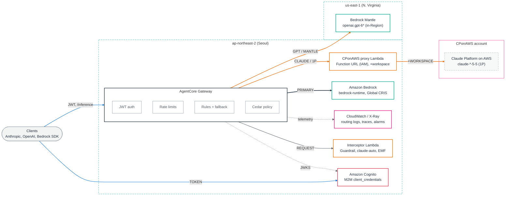
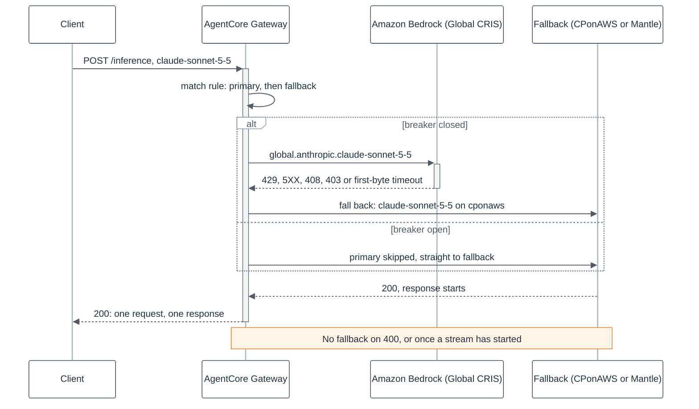
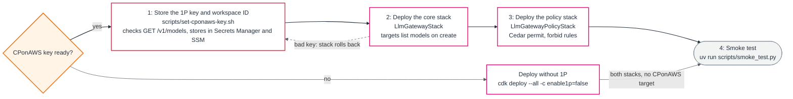

# Architecture

---

# English

## System Overview

agentcore-llm-gateway is an LLM gateway built on Amazon Bedrock AgentCore Gateway in ap-northeast-2 (Seoul).
It exposes one `/inference` endpoint that speaks the Anthropic Messages, OpenAI Chat Completions and Responses, and Bedrock InvokeModel APIs, and it is deployed with AWS CDK.
Every request is authenticated, rate-limited, routed by model name, checked by an interceptor and Cedar policies, and sent to Bedrock Global CRIS; eligible failures fall back to Claude Platform on AWS for Claude or to Bedrock Mantle in us-east-1 for GPT. Kimi has no fallback.

Rendered diagrams: [architecture.en.png](architecture.en.png), [request-flow.en.png](request-flow.en.png), [fallback-sequence.en.png](fallback-sequence.en.png), [deploy-order.en.png](deploy-order.en.png), and the page [architecture.en.html](architecture.en.html).

## Components

### Security Layer
- **lib/constructs/inbound-auth.ts** -- Amazon Cognito user pool with one machine-to-machine client per team. Access tokens carry `client_id` and `scope`, which the JWT authorizer, rate limits, and policies use.
- **lib/policy-stack.ts** -- Cedar policies in AgentCore Policy (ENFORCE). The `invoke` scope is required; Opus models and outputs above 16384 tokens require `premium`.
- **lib/constructs/guardrail-interceptor.ts** -- Bedrock Guardrail (Standard tier through the APAC guardrail profile) applied by the interceptor to the latest user turn.

### Ingestion Layer
- **lib/llm-gateway-stack.ts** -- AgentCore Gateway with the CUSTOM_JWT authorizer, per-team and per-model rate limits, and routing rules that pin each model to a primary and a fallback destination.

### Processing Layer
- **lambda/interceptor/** -- REQUEST interceptor: `claude-auto` routing, guardrail, API-dialect checks, InvokeModel limited to the premium scope (token rate limits do not count it and Cedar cannot see its model), refusal of undeclared models, per-team EMF metrics.
- **lambda/cponaws-proxy/** -- Lambda Function URL (AWS_IAM, response streaming) that adds the `anthropic-workspace-id` header and the API key before calling Claude Platform on AWS.

### AI/ML Layer
- **bedrock target** -- `bedrock-runtime` connector in Seoul; serves the Global CRIS profiles `global.anthropic.claude-*`, `global.openai.gpt-6*`, and `global.moonshotai.kimi-k3.1` for every primary route.
- **cponaws target** -- Claude fallback: Claude Platform on AWS (1P) in Seoul, reached through the proxy.
- **mantle target** -- GPT fallback: Bedrock Mantle in us-east-1 with in-Region model IDs under `/openai/v1`.

### Observability Layer
- **lib/constructs/observability.ts** -- Vended gateway logs and X-Ray traces (spans in `aws/spans` through Transaction Search, with Active tracing on both Lambdas), metric filters on `body.routing`, a CloudWatch dashboard, and alarms (faults, throttles, active fallback, Lambda errors, guardrail errors). The dashboard shows fallbacks by model, interceptor denials by reason (the `Denied` EMF metric), Bedrock tokens per minute and throttles per primary model, and span tables for target latency and fallback-served requests.

## Full Architecture Diagram

Zones and colors follow the AWS diagram: dashed teal borders are Regions, the pink border is the CPonAWS account, node borders use the AWS service category colors, and orange edges are fallback paths.

## Data Flow Summary

### Fallback Over Time

Rendered: [fallback-sequence.en.png](fallback-sequence.en.png).

## Infrastructure

### Deployment Region
- ap-northeast-2 (Seoul): every stack resource and both primary paths.
- us-east-1 (N. Virginia): Bedrock Mantle, called only on a GPT fallback.

### Deploy Order

Rendered: [deploy-order.en.png](deploy-order.en.png).

### Modules / Resources
| Module | Resources | Description |
|--------|-----------|-------------|
| LlmGatewayStack | AgentCore Gateway, gateway targets, gateway rules, rate limits, policy engine, gateway IAM role | The gateway and its routing |
| LlmGatewayStack | Cognito user pool, domain, resource server, team clients, team credential secrets | Inbound identity |
| LlmGatewayStack | Bedrock Guardrail and version, interceptor Lambda, CPonAWS proxy Lambda and Function URL | Request processing |
| LlmGatewayStack | Log delivery (logs, traces), log group, metric filters, dashboard, alarms, SNS topic | Observability |
| LlmGatewayPolicyStack | Cedar policies | Authorization, deployed after the core stack |
| Outside the stacks | Secrets Manager secret `llm-gateway/anthropic-api-key` | CPonAWS key, a deploy prerequisite |

### Deployed Resources
- Inference endpoint: `https://<gateway-id>.gateway.bedrock-agentcore.ap-northeast-2.amazonaws.com/inference`
- Token endpoint: `https://llm-gw-<account-id>.auth.ap-northeast-2.amazoncognito.com/oauth2/token`
- Dashboard: `llm-gateway-ap-northeast-2` in CloudWatch

## Key Design Decisions

- Use the `bedrock-runtime` connector for the primary -- Claude 5.5, GPT 6.x, and Kimi K3.1 Global CRIS profiles are served on `bedrock-runtime` only, and the connector also accepts Anthropic Messages and OpenAI requests.
- Fall back per model family -- Claude goes to Claude Platform on AWS because it is the 1P platform; GPT goes to Mantle us-east-1 because Seoul cannot call the `us.` profiles and Mantle has separate capacity and quotas.
- Serve Kimi K3.1 on Bedrock Global CRIS only -- no fallback target is configured for it, so a Bedrock error reaches the caller, and its route has no first-byte timeout (the rule schema keeps the timeout inside the fallback block). Like GPT, it is served only through the OpenAI APIs and InvokeModel.
- Put a streaming Lambda proxy in front of CPonAWS -- every CPonAWS request needs `anthropic-workspace-id`, a gateway target cannot add static headers, and the model discovery call at target creation bypasses interceptors.
- Apply the guardrail in the interceptor -- Guardrails in Policy is not offered in ap-northeast-2, and the interceptor applies one check to every primary and fallback path.
- Keep static aliases in rule `matchModels` -- rules match the model as sent, before the interceptor, so only rule-matched names get the fallback chain.
- Leave 400 out of the fallback triggers -- a malformed request fails on the fallback too and would only double the cost.
- Keep first-byte timeouts long (60 to 180 seconds) -- a non-streaming response sends its first byte only when generation ends, so a short timeout would fail over healthy requests.
- Keep the CPonAWS key outside the stacks -- the 1P target validates it at creation, and a stack-owned secret would be deleted on rollback.

---

# 한국어

## 시스템 개요

agentcore-llm-gateway는 ap-northeast-2(서울)의 Amazon Bedrock AgentCore Gateway로 만든 LLM Gateway입니다.
Anthropic Messages, OpenAI Chat Completions와 Responses, Bedrock InvokeModel API를 받는 `/inference` 엔드포인트 하나를 제공하며, AWS CDK로 배포합니다.
모든 요청은 인증, 요청 한도, 모델 이름 기반 라우팅, interceptor와 Cedar 정책 검사를 거쳐 Bedrock Global CRIS로 가고, fallback 대상 오류이면 Claude는 Claude Platform on AWS로, GPT는 us-east-1 Bedrock Mantle로 넘어갑니다. Kimi에는 fallback이 없습니다.

렌더링한 다이어그램: [architecture.ko.png](architecture.ko.png), [request-flow.ko.png](request-flow.ko.png), [fallback-sequence.ko.png](fallback-sequence.ko.png), [deploy-order.ko.png](deploy-order.ko.png), 페이지 [architecture.html](architecture.html).

## 구성 요소

### Security Layer
- **lib/constructs/inbound-auth.ts** -- 팀마다 machine-to-machine client를 하나씩 둔 Amazon Cognito user pool입니다. Access token에 담긴 `client_id`와 `scope`를 JWT authorizer, 요청 한도, 정책이 사용합니다.
- **lib/policy-stack.ts** -- AgentCore Policy(ENFORCE)의 Cedar 정책입니다. `invoke` scope가 필수이고, Opus 모델과 16384 토큰을 넘는 출력은 `premium`이 있어야 합니다.
- **lib/constructs/guardrail-interceptor.ts** -- APAC guardrail profile을 쓰는 Standard tier Bedrock Guardrail입니다. interceptor가 마지막 user 턴에 적용합니다.

### Ingestion Layer
- **lib/llm-gateway-stack.ts** -- CUSTOM_JWT authorizer, 팀별, 모델별 요청 한도, 모델마다 primary와 fallback 목적지를 고정하는 라우팅 rule을 갖춘 AgentCore Gateway입니다.

### Processing Layer
- **lambda/interceptor/** -- REQUEST interceptor입니다. `claude-auto` 라우팅, 가드레일, API dialect 검사, InvokeModel을 premium scope에만 허용(token rate limit에 집계되지 않고 Cedar가 모델을 볼 수 없음), 미등록 모델 거부, 팀별 EMF 메트릭을 맡습니다.
- **lambda/cponaws-proxy/** -- Lambda Function URL(AWS_IAM, 응답 스트리밍)입니다. `anthropic-workspace-id` 헤더와 API 키를 붙여 Claude Platform on AWS를 호출합니다.

### AI/ML Layer
- **bedrock target** -- 서울의 `bedrock-runtime` connector입니다. 모든 primary route에 Global CRIS 프로필 `global.anthropic.claude-*`, `global.openai.gpt-6*`, `global.moonshotai.kimi-k3.1`을 제공합니다.
- **cponaws target** -- Claude fallback입니다. 프록시를 거쳐 서울의 Claude Platform on AWS(1P)로 갑니다.
- **mantle target** -- GPT fallback입니다. us-east-1 Bedrock Mantle의 `/openai/v1` 경로에서 리전 내 모델 ID를 사용합니다.

### Observability Layer
- **lib/constructs/observability.ts** -- Gateway vended log와 X-Ray trace(Transaction Search로 `aws/spans`에 저장, 두 Lambda 모두 Active tracing), `body.routing` 기반 metric filter, CloudWatch 대시보드, 알람(fault, throttle, fallback 발생, Lambda 오류, 가드레일 오류)을 구성합니다. 대시보드는 모델별 fallback, 사유별 interceptor 거부(`Denied` EMF 메트릭), primary 모델별 Bedrock 분당 토큰과 throttle, 대상별 지연과 fallback 처리 요청을 보여 주는 span 표를 포함합니다.

## 전체 아키텍처 다이어그램

구역과 색은 AWS 다이어그램을 따릅니다. 청록 점선 테두리는 리전, 분홍 테두리는 CPonAWS 계정이고, 노드 테두리는 AWS 서비스 카테고리 색이며, 주황 선은 fallback 경로입니다.

## 데이터 흐름 요약

```mermaid
%%{init: {"flowchart": {"wrappingWidth": 400, "subGraphTitleMargin": {"top": 4, "bottom": 16}}}}%%
flowchart LR
  Req(["Client request"])
  S1["1: Inbound auth, rate limits<br/>Cognito JWT, per-team, per-model<br/>reject 401 / 429"]
  S2["2: Rule match<br/>model as sent → primary + fallback"]
  S3["3: Interceptor Lambda<br/>guardrail, claude-auto, dialect<br/>reject 400 / 403"]
  S4["4: Cedar policy<br/>invoke scope, premium, max tokens<br/>reject 403"]
  S5["5: Amazon Bedrock<br/>Global CRIS, Seoul<br/>fails over on 429, 5XX, 408, 403, timeout"]
  D{"6: Fallback?"}
  F1["Claude Platform on AWS<br/>via proxy λ, claude-*-5-5"]
  F2["Bedrock Mantle<br/>us-east-1, openai.gpt-6*"]
  Resp(["Response<br/>SSE stream or JSON"])

  Req --> S1 --> S2 --> S3 --> S4
  S4 -- allowed --> S5 --> D
  D -- no --> Resp
  D -- "yes, Claude" --> F1
  D -- "yes, GPT" --> F2
  F1 --> Resp
  F2 --> Resp

  classDef security fill:#ffffff,stroke:#DD344C,stroke-width:2px,color:#232F3E
  classDef step fill:#ffffff,stroke:#232F3E,stroke-width:1.5px,color:#232F3E
  classDef compute fill:#ffffff,stroke:#ED7100,stroke-width:2px,color:#232F3E
  classDef ai fill:#ffffff,stroke:#01A88D,stroke-width:2px,color:#232F3E
  classDef focal fill:#FFF4E5,stroke:#EC7211,stroke-width:2px,color:#232F3E
  classDef external fill:#F7F8F8,stroke:#879196,stroke-dasharray:4 4,color:#232F3E
  classDef io fill:#F2F3F3,stroke:#7D8998,color:#232F3E
  class S1 security
  class S2,S4 step
  class S3 compute
  class S5,F2 ai
  class D focal
  class F1 external
  class Req,Resp io
  linkStyle 0 stroke:#0972D3,stroke-width:1.5px
  linkStyle 1,2,3,4,5 stroke:#232F3E,stroke-width:1.5px
  linkStyle 6,9,10 stroke:#545B64
  linkStyle 7,8 stroke:#EC7211,stroke-width:2px
```

### 시간 순서로 본 Fallback

렌더링한 그림: [fallback-sequence.ko.png](fallback-sequence.ko.png).

## 인프라

### 배포 리전
- ap-northeast-2(서울): 스택의 모든 리소스와 두 primary 경로가 있습니다.
- us-east-1(버지니아 북부): Bedrock Mantle이 있으며, GPT fallback 때만 호출합니다.

### 배포 순서

렌더링한 그림: [deploy-order.ko.png](deploy-order.ko.png).

### 모듈 / 리소스
| 모듈 | 리소스 | 설명 |
|------|--------|------|
| LlmGatewayStack | AgentCore Gateway, gateway target, gateway rule, rate limit, policy engine, gateway IAM role | Gateway와 라우팅 |
| LlmGatewayStack | Cognito user pool, domain, resource server, 팀 client, 팀 자격증명 secret | 인바운드 인증 |
| LlmGatewayStack | Bedrock Guardrail과 버전, interceptor Lambda, CPonAWS 프록시 Lambda와 Function URL | 요청 처리 |
| LlmGatewayStack | Log delivery(log, trace), log group, metric filter, 대시보드, 알람, SNS topic | 관측성 |
| LlmGatewayPolicyStack | Cedar 정책 | 권한 부여, Core 스택 다음에 배포 |
| 스택 외부 | Secrets Manager secret `llm-gateway/anthropic-api-key` | CPonAWS 키, 배포 사전 조건 |

### 배포된 리소스
- Inference 엔드포인트: `https://<gateway-id>.gateway.bedrock-agentcore.ap-northeast-2.amazonaws.com/inference`
- Token 엔드포인트: `https://llm-gw-<account-id>.auth.ap-northeast-2.amazoncognito.com/oauth2/token`
- 대시보드: CloudWatch의 `llm-gateway-ap-northeast-2`

## 주요 설계 결정

- Primary에 `bedrock-runtime` connector 사용 -- Claude 5.5, GPT 6.x, Kimi K3.1의 Global CRIS 프로필은 `bedrock-runtime`에서만 제공되고, 이 connector는 Anthropic Messages와 OpenAI 요청도 받습니다.
- 모델 계열별 fallback -- Claude는 1P 플랫폼인 Claude Platform on AWS로 보냅니다. GPT는 서울에서 `us.` 프로필을 호출할 수 없고 Mantle의 용량과 quota가 별도이므로 Mantle us-east-1로 보냅니다.
- Kimi K3.1은 Bedrock Global CRIS로만 서빙 -- fallback 대상을 두지 않았으므로 Bedrock 오류가 그대로 호출자에게 가고, route에 first-byte timeout도 없습니다(rule 스키마에서 timeout은 fallback 블록 안에만 있습니다). GPT처럼 OpenAI API와 InvokeModel로만 서빙합니다.
- CPonAWS 앞에 스트리밍 Lambda 프록시 배치 -- CPonAWS는 모든 요청에 `anthropic-workspace-id`가 필요한데, gateway target은 고정 헤더를 넣을 수 없고 target 생성 시의 모델 discovery 호출은 interceptor를 거치지 않습니다.
- 가드레일을 interceptor에서 적용 -- ap-northeast-2에서는 Guardrails in Policy를 제공하지 않으며, interceptor는 모든 primary와 fallback 경로에 같은 검사를 적용합니다.
- 정적 alias는 rule의 `matchModels`에 둠 -- rule은 interceptor보다 먼저, 클라이언트가 보낸 model 값으로 매칭하므로 rule에 매칭된 이름만 fallback chain을 탑니다.
- 400은 fallback 조건에서 제외 -- 잘못된 요청은 fallback에서도 실패하므로 비용만 두 배가 됩니다.
- First-byte timeout은 길게(60~180초) 설정 -- 비스트리밍 응답은 생성이 끝나야 첫 바이트가 나가므로, 짧게 잡으면 정상 요청까지 fallback됩니다.
- CPonAWS 키는 스택 밖에 보관 -- 1P target이 생성 시점에 키를 검증하고, 스택이 소유한 secret은 롤백 때 삭제됩니다.
